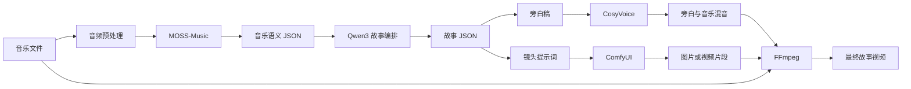

# 根据音乐进行故事创作的开源方案推荐

> 适用项目：MOSS-Music
>
> 目标：把一首音乐转换成结构化音乐理解、中文故事、旁白、分镜图片或短视频。
>
> 推荐原则：优先本地部署、组件可替换、先完成 MVP，再扩展视频生成。

## 1. 结论先行

推荐采用分层方案：

```text
音乐文件
    |
    v
MOSS-Music
音乐理解：情绪、结构、歌词、速度、乐器、和声
    |
    v
结构化音乐语义 JSON
    |
    v
Qwen3
故事、角色、情节、旁白和分镜脚本
    |
    +--> CosyVoice：中文旁白
    |
    +--> ComfyUI：图片和视频工作流
    |
    v
FFmpeg
音乐、旁白、字幕、图片或视频合成
```

最推荐的第一版组合：

```text
MOSS-Music-8B-Instruct
+ Qwen3-8B 或 Qwen3-4B
+ Python 状态机或 LangGraph
+ CosyVoice
+ 静态图片
+ FFmpeg
```

暂时不建议第一版就加入复杂的视频扩散模型。先验证“音乐特征是否能稳定转化成有一致性的中文故事”，再扩展视频。

## 2. MOSS-Music 的职责边界

MOSS-Music 是音乐理解模型，不是完整的故事创作模型。

它适合提取：

- 音乐风格、类型和标签；
- 整体情绪和情绪变化；
- 速度、节拍、调式和和弦；
- 乐器、人声和编曲；
- Intro、Verse、Chorus、Bridge、Outro 等曲式结构；
- 歌词和时间戳；
- 基于歌曲的音乐问答和长时分析。

它不专门负责：

- 故事世界观和人物关系；
- 长篇剧情和对白；
- 中文配音；
- 图片或视频生成；
- 最终音画剪辑。

因此，建议把 MOSS-Music 的输出转换成结构化 JSON，再交给文本模型进行故事创作。不要直接把一段自由文本当作唯一故事依据。

### 模型选择

| 模型 | 建议用途 |
| --- | --- |
| `MOSS-Music-8B-Instruct` | 默认选择，适合音乐描述、标签、歌词、结构和直接问答 |
| `MOSS-Music-8B-Thinking` | 需要更复杂的情绪发展、和声关系和长时音乐推理时使用 |

当前 Windows 环境推荐使用本地 HF Transformers 模式；SGLang 更适合 Linux/WSL2 服务化部署。具体启动方式见：

[MOSS-Music-Windows-HF-使用指南.md](MOSS-Music-Windows-HF-使用指南.md)

## 3. 开源组件推荐

| 层级 | 首选组件 | 作用 | 备注 |
| --- | --- | --- | --- |
| 音乐理解 | MOSS-Music | 从歌曲提取音乐语义 | 当前项目核心 |
| 中文故事 | Qwen3 | 生成故事、角色、对白、分镜 | 可本地运行，按显存选择规模 |
| 工作流 | Python 状态机或 LangGraph | 管理多阶段生成、重试和人工审核 | MVP 可先不用复杂框架 |
| 中文语音 | CosyVoice | 生成中文旁白和角色声音 | 声音克隆需要授权 |
| 图片工作流 | ComfyUI | 管理文生图、图生图、角色一致性和批量任务 | 节点式，可保存工作流 JSON |
| 图像模型 | SDXL、Flux、Qwen Image 等 | 生成角色、场景和关键帧 | 逐个核对模型许可证 |
| 视频模型 | Wan2.1、LTX-Video 等 | 生成动态镜头或短视频 | 显存和生成时间成本高 |
| 音画合成 | FFmpeg | 混音、拼接、字幕和视频输出 | 适合自动化脚本 |
| 服务接口 | Gradio 或 FastAPI | 上传音乐、查看状态和下载结果 | 当前项目已有 Gradio |

官方项目：

- [MOSS-Music](https://github.com/OpenMOSS/MOSS-Music)
- [Qwen3](https://github.com/QwenLM/Qwen3)
- [Qwen 官方文档](https://qwen.readthedocs.io/)
- [LangGraph](https://github.com/langchain-ai/langgraph)
- [CosyVoice](https://github.com/FunAudioLLM/CosyVoice)
- [GPT-SoVITS](https://github.com/RVC-Boss/GPT-SoVITS)
- [ComfyUI](https://github.com/comfyanonymous/ComfyUI)
- [Diffusers](https://github.com/huggingface/diffusers)
- [Wan2.1](https://github.com/Wan-Video/Wan2.1)

## 4. 三条落地路线

### 4.1 路线 A：推荐的本地 MVP

```text
MOSS-Music-8B-Instruct
    -> Qwen3-4B/8B
    -> CosyVoice
    -> 3-8 张静态图片
    -> FFmpeg
```

适合：个人创作者、研究原型、音乐故事 Demo、播客式内容。

优点：

- 组件少，最容易跑通；
- 可以全部本地运行；
- 方便单独替换故事模型或语音模型；
- 不需要一开始处理复杂的视频一致性。

建议输出：

1. 音乐分析报告；
2. 500-1500 字中文故事；
3. 旁白音频；
4. 3-8 张分镜图片；
5. 带字幕的音频故事视频。

**推荐等级：★★★★★**

### 4.2 路线 B：完整的本地多媒体生产线

```text
MOSS-Music-8B-Thinking
    -> Qwen3-14B 或更大模型
    -> LangGraph
    -> CosyVoice
    -> ComfyUI
    -> Wan2.1/LTX-Video
    -> FFmpeg
```

适合：长篇音乐故事、多角色有声故事、系列内容生产。

优点：

- 可以把音乐段落和镜头段落精确对应；
- 支持角色设定、场景设定和多轮人工审核；
- 图片、视频、旁白都可以在本地处理。

代价：

- 显存、磁盘和生成时间明显增加；
- 图片和视频模型容易发生角色不一致、动作跳变；
- 工作流、模型版本和节点依赖需要维护。

**推荐等级：★★★★☆**

### 4.3 路线 C：本地音乐理解 + 云端故事/媒体生成

音乐文件先在本地由 MOSS-Music 分析，只将结构化音乐 JSON 发送给远端文本或媒体服务。

适合：本地 GPU 不足、需要快速展示或多人协作的情况。

优点：

- 本地只运行音乐理解模型；
- 故事和视频生成速度更快；
- 前期工程成本较低。

风险：

- 音乐语义可能包含歌词或版权信息；
- 发送到云端前必须确认隐私和授权；
- 远端模型和 API 成本不可控；
- 不属于完全开源或完全离线方案。

**推荐等级：★★★☆☆**

## 5. 推荐 MVP 架构

### 5.1 第一版功能范围

第一版建议只做：

- 上传 MP3/WAV；
- MOSS-Music 生成音乐语义；
- Qwen3 生成中文故事；
- CosyVoice 生成旁白；
- 生成 3-8 个静态分镜；
- FFmpeg 合成音乐、旁白、图片和字幕。

第一版暂不做：

- 长篇连续剧；
- 全自动高质量视频；
- 未经授权的真人声音克隆；
- 自动发布到社交平台；
- 复杂的多角色实时对话。

### 5.2 数据流



### 5.3 建议的目录结构

```text
story_pipeline/
  input/
    song.mp3
  analysis/
    music_analysis.json
  story/
    story.json
    narration.txt
    storyboard.json
  audio/
    narration.wav
    mix.wav
  images/
    shot-001.png
    shot-002.png
  video/
    final.mp4
  prompts/
    music_analysis.txt
    story_generation.txt
    storyboard_generation.txt
```

## 6. 音乐语义 JSON

建议不要让 MOSS-Music 直接输出以下复杂结构。先让它输出受限的短文本分析，再由 Python
封装为中间 JSON，最后交给 Qwen3 等文本模型生成并校验完整结构。

验证发现，直接要求 MOSS-Music 一次性输出复杂嵌套 JSON，容易出现重复键、数组退化为对象、
无限重复字段和不闭合括号。因此 `music-story/0.2` 是下游数据契约，不应强制由音乐模型直接完成：

```text
MOSS-Music -> 四段短文本音乐分析
            -> Python 确定性封装为中间 JSON
            -> Qwen3 等文本模型结构化为 music-story/0.2
            -> JSON Schema 校验
```

下面的结构仍然作为下游 `music_analysis.json` 的目标契约：

```json
{
  "schema_version": "music-story/0.1",
  "source": {
    "audio_path": "input/song.mp3",
    "duration_seconds": 214.6,
    "language": "zh"
  },
  "music_analysis": {
    "genre": ["cinematic pop", "electronic"],
    "mood": ["nostalgic", "hopeful"],
    "tempo_bpm": 96,
    "key": "A minor",
    "instruments": ["piano", "strings", "electronic drums"],
    "vocal": {
      "present": true,
      "style": "solo female vocal"
    },
    "sections": [
      {
        "id": "intro",
        "start": 0.0,
        "end": 16.0,
        "energy": 0.35,
        "emotion": "quiet"
      },
      {
        "id": "chorus_1",
        "start": 48.0,
        "end": 82.0,
        "energy": 0.88,
        "emotion": "release"
      }
    ],
    "lyrics": [],
    "harmonic_events": [],
    "caption": "一首以钢琴和弦乐为核心、逐渐走向明亮高潮的怀旧流行歌曲"
  },
  "uncertainties": [
    {
      "field": "key",
      "confidence": 0.62,
      "note": "调式可能存在相对大小调歧义"
    }
  ]
}
```

建议保留 `uncertainties` 字段。音乐模型的调式、和弦和歌词识别都可能存在不确定性，故事模型不应该把低置信度结果当作事实。

## 7. 用于故事创作的完整音乐理解 JSON

### 7.1 设计原则

这个 JSON 不是简单的音乐标签列表，而是后续故事模型的输入契约。建议同时保存：

- 可直接从音频判断的音乐事实；
- 带起止时间的曲式和能量变化；
- 歌词原文与歌词意象；
- 适合转化为故事的情绪、空间、人物和冲突线索；
- 每个判断的置信度；
- 无法确认、可能冲突或需要人工复核的内容。

故事模型只能把 `confidence` 较高的事实当成硬约束。低置信度内容只能作为灵感，不能写成确定事实。

### 7.2 推荐 JSON 模板

下面的模板可以作为 `music_analysis.json` 的字段约定。没有把握的字段使用 `null`、空数组或
`uncertainties`，不要猜测填充。

```json
{
  "schema_version": "music-story/0.2",
  "analysis_status": "complete",
  "source": {
    "audio_path": "input/song.mp3",
    "file_name": "song.mp3",
    "duration_seconds": 214.6,
    "sample_rate": 16000,
    "language": "zh",
    "has_vocals": true
  },
  "global_music_profile": {
    "genres": [
      {
        "label": "cinematic pop",
        "confidence": 0.84,
        "evidence": "钢琴、弦乐和流行鼓组共同构成编曲基础"
      }
    ],
    "subgenres": [],
    "overall_mood": [
      {
        "label": "nostalgic",
        "label_zh": "怀旧",
        "confidence": 0.86,
        "evidence": "旋律重复、和声色彩和人声演唱方式共同形成回望感"
      },
      {
        "label": "hopeful",
        "label_zh": "希望",
        "confidence": 0.68,
        "evidence": "高潮段能量提升，结尾没有明显的悲剧终止感"
      }
    ],
    "tempo": {
      "bpm": 96,
      "tempo_label": "moderate",
      "tempo_change": "stable",
      "confidence": 0.72
    },
    "meter": {
      "time_signature": "4/4",
      "confidence": 0.75
    },
    "key_and_harmony": {
      "key": "A minor",
      "mode": "minor",
      "confidence": 0.62,
      "harmonic_character": ["melancholic", "open", "gradually resolving"]
    },
    "sonic_texture": ["warm piano", "wide strings", "soft electronic drums"],
    "production_style": ["clean", "spacious", "cinematic build"],
    "overall_caption": "一首从克制的钢琴与人声开始，逐步加入弦乐和鼓组并走向明亮高潮的怀旧流行歌曲。"
  },
  "vocal_profile": {
    "present": true,
    "voice_count": 1,
    "lead_voice": {
      "gender_presentation": "female",
      "register": "mid",
      "delivery": ["restrained", "breathy", "emotional"],
      "confidence": 0.65
    },
    "backing_vocals": "subtle",
    "performance_emotion": ["intimate", "yearning"],
    "vocal_uncertainties": []
  },
  "instrumentation": [
    {
      "instrument": "piano",
      "role": "harmonic foundation",
      "prominence": 0.86,
      "first_appears_seconds": 0.0,
      "sections": ["intro", "verse_1", "outro"],
      "confidence": 0.86
    },
    {
      "instrument": "strings",
      "role": "emotional lift",
      "prominence": 0.72,
      "first_appears_seconds": 42.0,
      "sections": ["pre_chorus_1", "chorus_1", "chorus_2"],
      "confidence": 0.7
    }
  ],
  "sections": [
    {
      "id": "intro",
      "order": 1,
      "label": "Intro",
      "start_seconds": 0.0,
      "end_seconds": 16.0,
      "duration_seconds": 16.0,
      "energy": 0.32,
      "energy_change": "rising",
      "density": 0.28,
      "emotion": ["quiet", "distant"],
      "musical_events": ["solo piano", "sparse texture"],
      "vocal_content": null,
      "story_function": ["establish setting", "introduce absence", "create anticipation"],
      "visual_ideas": ["清晨", "空房间", "海边", "未寄出的信"],
      "confidence": 0.88
    },
    {
      "id": "chorus_1",
      "order": 4,
      "label": "Chorus",
      "start_seconds": 48.0,
      "end_seconds": 82.0,
      "duration_seconds": 34.0,
      "energy": 0.88,
      "energy_change": "peak",
      "density": 0.84,
      "emotion": ["release", "yearning", "hopeful"],
      "musical_events": ["full drums", "strings widen", "lead vocal intensifies"],
      "vocal_content": {
        "summary": "反复出现与等待、离开或重新相遇有关的核心意象",
        "lyrics": [],
        "lyric_confidence": 0.0
      },
      "story_function": ["turning point", "emotional reveal", "externalize conflict"],
      "visual_ideas": ["奔跑", "打开信件", "人群中寻找某人", "光线突然变亮"],
      "confidence": 0.82
    }
  ],
  "emotion_arc": [
    {
      "start_seconds": 0.0,
      "end_seconds": 16.0,
      "primary_emotion": "loneliness",
      "secondary_emotions": ["calm", "anticipation"],
      "intensity": 0.32,
      "change_reason": "稀疏编曲和低密度织体"
    },
    {
      "start_seconds": 48.0,
      "end_seconds": 82.0,
      "primary_emotion": "release",
      "secondary_emotions": ["yearning", "hope"],
      "intensity": 0.88,
      "change_reason": "鼓组、弦乐和人声共同增强"
    }
  ],
  "lyrics": {
    "available": true,
    "language": "zh",
    "lines": [
      {
        "id": "lyric-001",
        "start_seconds": 52.4,
        "end_seconds": 58.1,
        "text": "示例歌词",
        "confidence": 0.78,
        "themes": ["distance", "memory"],
        "literal_entities": [],
        "imagery": ["海", "夜晚", "旧信"],
        "story_relevance": "可作为人物过去经历的线索，但不能直接断言为真实事件"
      }
    ],
    "global_themes": ["separation", "memory", "return"],
    "repeated_phrases": [],
    "copyright_note": "歌词只用于内部分析和故事灵感，不应未经授权完整转载到公开内容中。"
  },
  "narrative_material": {
    "core_emotional_question": "一个人如何面对无法挽回的离开？",
    "possible_themes": ["告别", "记忆", "重新出发"],
    "possible_settings": ["海边小城", "深夜车站", "旧唱片店", "雨后的街道"],
    "possible_character_archetypes": ["等待的人", "离开的人", "保存秘密的人"],
    "possible_objects": ["未寄出的信", "旧录音机", "车票", "褪色照片"],
    "possible_conflicts": ["等待与放下", "记忆与现实", "重逢愿望与无法重逢的事实"],
    "story_hooks": [
      "主角在歌曲高潮到来前打开一封保存多年的信",
      "一段旋律让主角发现旧录音中隐藏着另一个人的声音"
    ],
    "do_not_assume": [
      "不要把歌词中的第一人称直接当成真实歌手经历",
      "不要把音乐情绪直接等同于故事结局",
      "不要在没有听清歌词时编造具体人名、地点或事件"
    ]
  },
  "story_mapping_hints": [
    {
      "music_section": "intro",
      "recommended_story_role": "setup",
      "reason": "低能量和稀疏织体适合建立人物、地点和未解决的问题"
    },
    {
      "music_section": "chorus_1",
      "recommended_story_role": "turning_point_or_climax",
      "reason": "能量达到高点，适合揭示秘密、做出选择或完成情绪释放"
    }
  ],
  "uncertainties": [
    {
      "field": "key_and_harmony.key",
      "confidence": 0.62,
      "severity": "medium",
      "note": "可能存在相对大小调歧义，不应作为故事事实"
    }
  ],
  "analysis_notes": [
    "本 JSON 将音乐事实、解释性判断和故事灵感分开保存。",
    "story_hooks、possible_settings 和 possible_conflicts 只是创作建议，不是音频事实。"
  ]
}
```

### 7.3 字段使用规则

| 字段 | 后续故事模型的使用方式 |
| --- | --- |
| `source` | 确认歌曲时长、语言和是否有人声，不用于编造故事 |
| `global_music_profile` | 确定故事总体气质、时代感和叙事节奏 |
| `vocal_profile` | 作为叙述视角、人物声音或情绪表达的参考 |
| `instrumentation` | 转换成场景质感、道具、空间和视觉材质 |
| `sections` | 绑定故事段落、镜头时长和剧情节拍 |
| `emotion_arc` | 控制故事情绪由开场到高潮再到结尾的变化 |
| `lyrics` | 提取主题和意象，不默认当作真实人物经历 |
| `narrative_material` | 只作为创作候选，不应全部照搬 |
| `story_mapping_hints` | 帮助故事模型把音乐段落映射到剧情结构 |
| `uncertainties` | 防止低置信度音乐判断变成错误剧情事实 |

## 8. 详细音乐理解提示词

### 8.0 实际验证后的输出策略

第 8.2 节的完整 JSON 提示词适合交给文本结构化模型，不建议直接交给 MOSS-Music。
MOSS-Music 应使用第 8.3 节的短文本分阶段提示词；程序再把四段文本封装为合法 JSON。

### 8.0 生成参数建议

完整音乐 JSON 比普通音乐描述长很多，不能继续使用默认的 1024 tokens。建议在 Gradio
的 Advanced Settings 中使用：

| 参数 | 建议值 | 说明 |
| --- | ---: | --- |
| `Max New Tokens` | `4096` | 完整音乐语义 JSON 的默认起点 |
| `Temperature` | `0.0` | 需要严格 JSON 时优先使用，减少重复键和跑题 |
| `Top-p` | `0.9` | Temperature 大于 0 时使用 |
| `Top-k` | `40` | Temperature 大于 0 时使用 |

如果 JSON 仍然在结尾被截断，可以将 `Max New Tokens` 提高到 `6144` 或 `8192`，同时
减少提示词中不必要的示例和字段。`Max New Tokens` 是输出上限，不是保证模型一定会输出
完整 JSON；模型仍可能因为上下文长度、显存或生成退化而提前结束。

如果输出末尾没有闭合的 `}` 或 `]`，它就是不完整 JSON。不要直接交给故事模型，应该：

1. 保留原始输出用于排查；
2. 重试一次，使用 `Temperature=0`；
3. 缩短输入提示词或拆成“全局画像、曲式时间线、歌词意象、故事映射”四次请求；
4. 对每一段分别解析并合并，而不是强行给截断文本补括号。

下面的提示词可以直接作为 MOSS-Music 的问题输入。建议使用 `MOSS-Music-8B-Instruct`，并要求模型只输出 JSON。

### 8.1 系统提示词

```text
你是一个严谨的音乐理解与叙事素材分析器，不是故事作者。

你的任务是：只根据输入音频中可以听到、识别或合理推断的内容，生成结构化的音乐语义 JSON，供后续中文故事模型使用。

必须遵守以下规则：

1. 不要编造没有听到的歌词、乐器、人物、地点、事件或歌手经历。
2. 区分“音频事实”“音乐解释”和“故事灵感”。
3. 所有不确定判断都必须填写 confidence，范围为 0 到 1。
4. 置信度低于 0.65 的内容必须同时写入 uncertainties。
5. 无法判断的字段使用 null、空数组或空字符串，不要用猜测填充。
6. 歌词听不清时不要补全。只能输出能确认的片段，或将 lyrics.available 设为 false。
7. 不要把歌词中的第一人称、地点或事件当作歌手的真实经历。
8. 不要把音乐情绪直接等同于故事结局。音乐可以提供情绪和结构，故事事实需要后续模型创作。
9. 每个 sections 必须有 start_seconds、end_seconds，且不能超出音频时长。
10. sections 的时间不能重叠，除非明确说明是重叠声部或过渡段。
11. emotion_arc 必须体现音乐情绪或能量如何变化，而不是只列出形容词。
12. narrative_material 和 story_mapping_hints 是创作建议，不是音乐事实，必须明确标注为建议。
13. 只输出合法 JSON，不要输出 Markdown 代码块、解释文字或 JSON 前后的句子。
14. JSON 字符串使用双引号；不能使用注释、尾逗号或 Python 字典语法。
15. 如果输入音频不足以完成分析，也必须返回完整 JSON，并在 analysis_status 和 uncertainties 中说明原因。
```

### 8.2 用户提示词

```text
请分析这段音乐，并严格按照 MUSIC_STORY_JSON_SCHEMA 输出 JSON。

分析目标：

一、音乐整体画像
- 判断主要类型和可能的子类型；
- 描述整体情绪、情绪混合和情绪变化；
- 判断速度、节拍、调式和和声性格；
- 描述音色、空间感、动态范围和制作风格；
- 生成一段不超过 100 字的客观整体描述。

二、人声和演唱
- 判断是否有人声；
- 判断人声数量、主唱和伴唱关系；
- 描述演唱的力度、音域、气息、咬字、情绪和表演方式；
- 无法可靠判断性别、年龄或身份时必须填 null，不得猜测。

三、乐器和编曲
- 列出可以确认的主要乐器；
- 说明每种乐器在编曲中的角色；
- 记录它大约何时出现、在哪些段落突出；
- 区分“明确听到”和“可能类似”的声音。

四、曲式和时间线
- 识别 Intro、Verse、Pre-Chorus、Chorus、Bridge、Outro、Instrumental 等段落；
- 为每个段落提供起止秒数、持续时间、能量、密度和情绪；
- 记录段落之间的变化，例如加入鼓组、弦乐变宽、人声增强、突然留白或调性变化；
- 如果段落名称不确定，使用 neutral_section_01 这类中性名称，并降低置信度。

五、情绪弧线
- 按时间分段描述情绪的起点、发展、转折、高潮和收束；
- 同时给出 0 到 1 的 intensity；
- 说明情绪变化对应的音乐证据；
- 不要只写“很悲伤”或“很治愈”，要说明是哪些声音造成这种判断。

六、歌词和语义意象
- 尽可能识别可以确认的歌词片段及时间戳；
- 对每个片段提取主题、意象和可能的叙事功能；
- 听不清的歌词不要猜；
- 记录重复的词、意象和情绪主题；
- 不要完整转载受版权保护的歌词，输出短片段、摘要或意象即可。

七、故事创作素材
- 根据音乐提出可能的主题、场景、人物原型、道具、冲突和故事钩子；
- 每条灵感都必须标记为 possible 或 suggested，不得伪装成音频事实；
- 故事素材应尽量由音乐的结构、情绪、音色和歌词意象推导出来；
- 至少给出 3 个不同方向的故事钩子，但不要直接写完整故事。

八、故事段落映射
- 指出每个重要音乐段落更适合承担 setup、rising_action、turning_point、climax、falling_action 或 ending 中的哪一种功能；
- 解释映射理由；
- 如果歌曲没有明显高潮或结尾，必须如实说明。

九、不确定性和质量控制
- 列出调式、和弦、歌词、乐器、人声等方面的不确定项；
- 对每个不确定项给出 confidence、影响范围和建议处理方式；
- 检查所有时间戳是否在音频范围内；
- 检查 sections 是否按时间排序；
- 检查 JSON 是否可以被标准 JSON 解析器读取。

输出要求：
- 顶层字段必须包括 schema_version、analysis_status、source、global_music_profile、vocal_profile、instrumentation、sections、emotion_arc、lyrics、narrative_material、story_mapping_hints、uncertainties、analysis_notes；
- 使用中文描述解释性字段；
- genre、instrument 等标签可以保留英文并提供中文含义；
- 数字字段必须是数字，不要写成带单位的字符串；
- 不确定数值使用 null；
- 最终只输出 JSON。

MUSIC_STORY_JSON_SCHEMA：
请按照本项目文档“用于故事创作的完整音乐理解 JSON”中的 schema_version music-story/0.2 输出。
```

### 8.3 分阶段提示词方案

如果一次提示词太长，建议拆成四次请求。每次请求都带上歌曲和已有 JSON，最后由程序合并结果。

#### 请求一：全局音乐画像

```text
只分析音乐整体画像：类型、子类型、速度、节拍、调式、和声性格、整体情绪、音色、制作风格和人声概况。
输出 global_music_profile 和 vocal_profile 两个 JSON 字段。
所有判断提供 confidence 和 evidence，不要生成故事。
```

#### 请求二：曲式和时间线

```text
只分析音乐时间线。识别所有曲式段落，输出 sections 和 emotion_arc。
每个段落必须包含 start_seconds、end_seconds、energy、density、emotion、musical_events、confidence。
严格按时间排序，不要输出故事。
```

#### 请求三：歌词和叙事意象

```text
只分析歌词和可用于故事创作的语义意象。
输出 lyrics 和 narrative_material。
听不清的歌词不要猜；故事钩子只能标记为 possible 或 suggested，不得写成事实。
```

#### 请求四：故事映射建议

```text
根据已经生成的音乐 JSON，为每个主要 music_section 建议一个故事功能：setup、rising_action、turning_point、climax、falling_action 或 ending。
输出 story_mapping_hints 和 uncertainties。
不要写完整故事，不要修改音乐事实。
```

### 8.4 JSON 输出失败时的修复提示词

如果 MOSS-Music 输出了 Markdown、额外解释或不合法 JSON，可以把原始输出交给一个文本模型做格式修复：

```text
你是 JSON 修复器，不是内容改写器。
请将下面的模型输出修复为合法 JSON。

要求：
1. 不新增原文没有的音乐事实；
2. 不删除任何可以保留的信息；
3. 无法解析的内容放入 analysis_notes 或 uncertainties；
4. 修复数字、双引号、数组、对象和尾逗号；
5. 删除 JSON 代码块标记和 JSON 外部解释；
6. 最终只输出合法 JSON。

原始输出：
{{RAW_MODEL_OUTPUT}}
```

## 9. 给故事模型的输入提示词

```json
{
  "story": {
    "title": "潮汐之后",
    "logline": "一名在海边等待旧友的年轻人，随着一首歌重新理解了告别。",
    "genre": "现实主义抒情",
    "theme": "告别、记忆与重新出发",
    "characters": [
      {
        "id": "lin",
        "name": "林澈",
        "role": "protagonist",
        "goal": "确认自己是否已经准备好告别过去",
        "traits": ["克制", "敏感", "可靠"]
      }
    ],
    "beats": [
      {
        "id": "setup",
        "music_section": "intro",
        "summary": "主角在安静的海边整理旧物。"
      },
      {
        "id": "turn",
        "music_section": "verse_1",
        "summary": "歌词中的意象让主角想起一次未完成的约定。"
      },
      {
        "id": "climax",
        "music_section": "chorus_1",
        "summary": "音乐进入高潮，主角终于打开最后一封信。"
      },
      {
        "id": "ending",
        "music_section": "outro",
        "summary": "主角把信放入海风中，转身走向清晨。"
      }
    ]
  },
  "shots": [
    {
      "id": "shot-001",
      "music_section": "intro",
      "duration_seconds": 16.0,
      "narration": "海浪还没有完全醒来，林澈已经坐在礁石上。",
      "visual_prompt": "清晨海边，单人背影，冷蓝色，安静电影感，远景",
      "camera": "slow push in",
      "subtitle": "海浪还没有完全醒来"
    }
  ]
}
```

### 9.1 故事生成提示词

```text
你是一名中文短篇故事编剧。
请根据 MUSIC_JSON 创作一个可以被朗读和配图的中文故事。

要求：
- 不要逐句解释音乐分析；
- 将情绪、曲式变化和歌词意象转化为人物行动；
- 角色数量不超过 4 个；
- 先生成故事结构，再生成正文；
- 每个主要情节必须绑定一个 music_section；
- 不把低置信度音乐字段当作确定事实；
- 避免空泛的“音乐很悲伤，所以人物很悲伤”；
- 使用具体场景、动作、冲突和选择；
- 输出严格 JSON。

输出字段：title、logline、theme、characters、beats、narration、shots。
```

### 9.2 质量检查提示词

```text
请检查 STORY_JSON 是否满足：
1. 故事是否有开端、发展、转折、高潮和结尾；
2. 每个 beat 是否有对应的音乐段落；
3. 人物目标是否推动了情节；
4. 故事是否出现互相矛盾的时间、地点或人物关系；
5. 是否把音乐分析中的不确定字段误写成事实；
6. 旁白是否适合朗读；
7. 镜头提示词是否可以交给图片模型执行。

输出 errors、warnings、repair_actions 三个数组。
```

## 9. 编排方式选择

### Python 状态机

适合 MVP：

```text
LOAD_AUDIO
  -> ANALYZE_MUSIC
  -> VALIDATE_MUSIC_JSON
  -> GENERATE_STORY
  -> VALIDATE_STORY_JSON
  -> GENERATE_NARRATION
  -> GENERATE_IMAGES
  -> RENDER_VIDEO
```

优点是依赖少、调试容易、适合当前项目。

### LangGraph

当出现以下需求时再引入：

- 任务可以暂停和恢复；
- 需要人工审核后再继续；
- 某一步失败后自动重试；
- 不同故事路线并行生成；
- 需要保存每一步的状态和中间结果。

不要为了“看起来像 AI 工作流”而一开始引入复杂编排框架。

## 10. 显存和部署建议

当前 MOSS-Music Windows HF 方案使用 4bit bitsandbytes 量化，但总显存不只包含模型权重，还包括：

- 音频编码器；
- 激活值；
- KV Cache；
- CUDA 上下文；
- 生成过程的临时张量。

建议：

- 先让 MOSS-Music 和故事模型分时运行；
- 12 GB 显存先做短音频和短故事；
- 降低 `max_new_tokens`，缩短输入音频；
- 图片和视频模型不要与音乐模型同时常驻显存；
- 视频生成单独使用另一台 GPU 或任务队列；
- 保存每次生成的模型版本、提示词和随机种子。

如果需要多人并发，建议把每个阶段拆成独立服务：

```text
FastAPI Gateway
  -> Music Analysis Worker
  -> Story Worker
  -> TTS Worker
  -> Image/Video Worker
  -> Render Worker
```

## 11. 许可证和版权注意事项

“开源”不等于“所有场景都可以商用”。发布产品前至少要分别确认：

1. 代码许可证；
2. 模型权重许可证；
3. 训练数据和输入音乐的使用权；
4. 生成图片、视频和音频的使用条款；
5. 歌词的版权；
6. 真人声音、音色和人物形象的授权。

需要特别注意：

- MOSS-Music、Qwen、CosyVoice、Diffusers 等项目的代码和权重可能有不同条款；
- ComfyUI 本体为 GPL-3.0，集成和分发时需要单独审查 GPL 义务；
- Wan、LTX、SDXL、Flux、Qwen Image 等模型必须以各自模型仓库的许可证为准；
- GPT-SoVITS 或 CosyVoice 的声音克隆功能不能用于未经授权的真人声音仿制；
- 上传到云端的音乐、歌词和人物资料需要先获得相应授权。

## 12. 分阶段实施计划

### 第 1 阶段：音乐到故事文本

- 使用当前 MOSS-Music HF 应用；
- 增加结构化音乐分析提示词；
- 保存 `music_analysis.json`；
- 接入一个本地 Qwen3 文本模型；
- 保存 `story.json`；
- 人工检查故事与音乐段落的对应关系。

验收标准：同一首音乐重复生成时，故事主题和段落结构基本稳定，且没有明显编造歌词。

### 第 2 阶段：故事到旁白

- 接入 CosyVoice；
- 将旁白拆成段落；
- 控制旁白速度和停顿；
- 将旁白与原音乐进行音量混合；
- 输出 WAV 或 MP3。

验收标准：旁白可清晰听懂，音乐不遮挡人声，段落顺序和故事一致。

### 第 3 阶段：故事到静态分镜

- 生成角色设定表；
- 生成场景设定表；
- 输出每个镜头的图片提示词；
- 通过 ComfyUI 批量生成图片；
- 使用 FFmpeg 制作带字幕的图片视频。

验收标准：角色外观基本一致，镜头顺序和音乐结构对应。

### 第 4 阶段：动态视频扩展

- 只为高潮或关键镜头生成视频；
- 其余段落继续使用静态图片和转场；
- 增加失败重试和人工选片；
- 最后再考虑全片视频化。

验收标准：关键镜头动作可接受，生成失败不会阻塞整条流水线。

## 13. 最终推荐

对于当前项目，推荐按下面顺序实施：

```text
第一步：MOSS-Music + Qwen3，先生成稳定的故事 JSON
第二步：加入 CosyVoice，生成中文旁白
第三步：加入静态分镜和 FFmpeg
第四步：用 ComfyUI 扩展图片工作流
第五步：最后再引入 Wan/LTX 等视频模型
```

最小可行版本不需要一次安装所有模型。先让“音乐事实 → 故事结构 → 中文正文”这条链路稳定，再增加声音、图片和视频，整体风险和显存压力都会更低。
